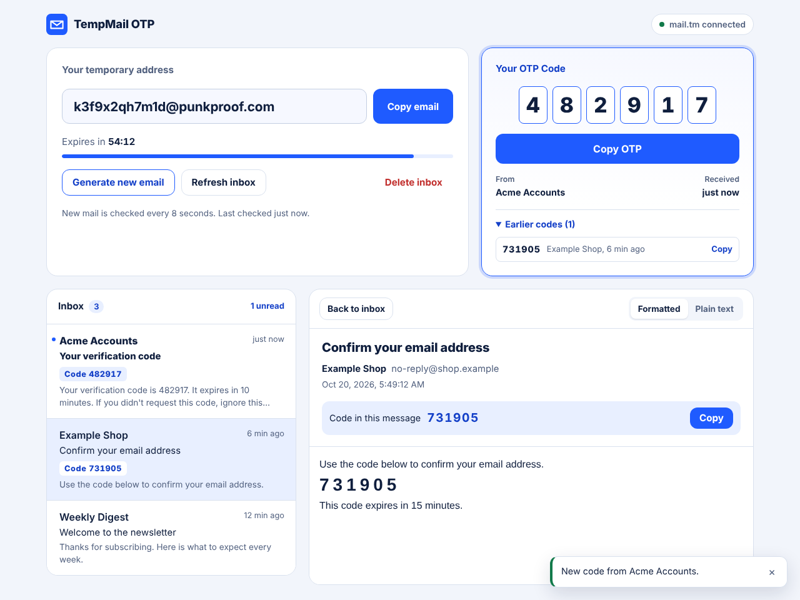

# TempMail OTP Generator

A responsive website that creates temporary email addresses, receives **real** incoming email,
detects one-time passcodes (OTPs) automatically and shows them in a copy-ready box.

- **Frontend:** Angular 21 (standalone components, signals, zoneless), TypeScript, HTML, CSS
- **Backend:** ASP.NET Core Web API on .NET 10 (C#), OpenAPI + Swagger UI
- **Database:** Microsoft SQL Server via Entity Framework Core 10 (migrations included)
- **Email provider:** [mail.tm](https://mail.tm) public API (real mailboxes, no API key), behind a provider interface; plus a clearly labeled demo mode



<sub>Preview rendered from the project's CSS with sample data.</sub>

---

## Build status — read this first

This project was written in a sandbox without access to NuGet, npm, the .NET SDK, SQL Server or the
mail.tm API. Here is exactly what was and was not verified there:

| Check | Status |
| --- | --- |
| OTP heuristic run against 47 cases (28 codes, 19 look-alikes) via a JavaScript port | ✅ 47/47 pass (`tools/otp-harness`) |
| Frontend TypeScript type-checked (strict) against minimal Angular/RxJS type stubs | ✅ no errors |
| Template ↔ component member cross-check; UI rendered and screenshotted at desktop and mobile widths | ✅ |
| `dotnet build` / `dotnet test` (backend + 80 xUnit test cases) | ⚠️ **not run** — no .NET SDK available |
| `ng build` (Angular compiler, templates) | ⚠️ **not run** — no npm access |
| EF Core migration applied to SQL Server | ⚠️ **not run** — migration was hand-written to match the model |
| Live mail.tm round trip | ⚠️ **not run** — host blocked from the sandbox |

**Your first steps should be:** `dotnet test`, `dotnet ef migrations has-pending-model-changes`, and `npm run build`
(commands below). If anything fails, the error output will point at the exact line.

---

## How it works

```
Angular app ──HTTP + X-Inbox-Token──► ASP.NET Core API ──► IEmailProvider ──► mail.tm (or Demo)
   │  polls every N s                     │
   │                                      ├─ OtpDetector (subject + HTML/text body → code)
   │                                      ├─ EmailHtmlSanitizer (allow-list, no remote images)
   └─ OTP box / inbox / details           └─ EF Core → SQL Server (TemporaryInboxes, ReceivedEmails, DetectedOtps)
```

1. **Generate** creates a mailbox at the provider, stores it with an expiry, and returns an
   unguessable inbox id plus a one-time-shown access token.
2. The browser **polls** `GET /messages`. The API syncs with the provider at most every
   `SyncIntervalSeconds`, downloads only new messages, sanitizes HTML, runs OTP detection and stores the results.
3. The newest detected OTP appears in the **OTP box**; earlier codes are kept in a history list.
4. Inboxes **expire** on the server (`410 Gone`), and a background job deletes expired inboxes
   (and their provider mailboxes) after a retention period.

---

## Prerequisites

| Tool | Version |
| --- | --- |
| .NET SDK | 10.0 or later |
| Node.js | 20.19+, 22.12+ or 24+ (Angular 21 requirement) |
| SQL Server | LocalDB (Windows, ships with Visual Studio), SQL Server 2019+, or Docker |
| Docker (optional) | For the bundled SQL Server container |

The server running the API needs outbound HTTPS access to `api.mail.tm`.

---

## Setup and run

### 1. Database

**Option A — LocalDB (Windows):** nothing to do. The default connection string in
`backend/src/TempMailOtp.Api/appsettings.json` points to `(localdb)\MSSQLLocalDB`.

**Option B — Docker (any OS):**

```bash
cp .env.example .env          # then edit MSSQL_SA_PASSWORD
docker compose up -d
```

Point the API at it with user secrets (kept outside the repository):

```bash
cd backend/src/TempMailOtp.Api
dotnet user-secrets set "ConnectionStrings:TempMailDb" "Server=localhost,1433;Database=TempMailOtp;User Id=sa;Password=<your password>;TrustServerCertificate=True;Encrypt=True"
```

### 2. Backend

```bash
cd backend
dotnet tool restore                      # installs dotnet-ef from .config/dotnet-tools.json
dotnet restore
dotnet build

# Create/upgrade the database (also happens automatically in Development on startup)
dotnet ef database update --project src/TempMailOtp.Api

# Confirm the hand-written migration matches the model (should print "No changes")
dotnet ef migrations has-pending-model-changes --project src/TempMailOtp.Api

dotnet run --project src/TempMailOtp.Api --launch-profile http
```

- API: <http://localhost:5080>
- Swagger UI: <http://localhost:5080/swagger> (OpenAPI document at `/openapi/v1.json`)
- Health: <http://localhost:5080/health>

Run the tests (in-memory SQLite + demo provider, no network or SQL Server needed):

```bash
dotnet test
```

### 3. Frontend

```bash
cd frontend
npm install
npm start                 # http://localhost:4200, talks to http://localhost:5080/api
npm run build             # production build → dist/tempmail-otp-web/browser
```

The development API URL is in `src/environments/environment.development.ts`; the production build
uses `/api` on the same origin (`src/environments/environment.ts`).

### 4. Try it

1. Open <http://localhost:4200> and click **Generate email**.
2. Use the address on any sign-up or login form that sends a verification code.
3. Within a few seconds the message appears in the inbox and the code fills the **Your OTP Code** box.
   Click **Copy OTP**.

No real email handy? Start the API with `EmailProvider__Provider=Demo` and use **Send test email**
(see Demo mode below).

---

## Email provider

### mail.tm (default, real email)

- **No account, API key, domain or DNS setup is required.** Each generated inbox is a mail.tm
  account with a random password. The password and bearer token are encrypted at rest with
  ASP.NET Core Data Protection and never sent to the browser.
- Domains are fetched from mail.tm (`GET /domains`) and cached; only active public domains are used.
- Outbound calls are throttled to `MaxRequestsPerSecond` (default 6) because mail.tm allows
  **8 requests per second per IP**. Server-side sync intervals keep polling from multiplying provider calls.
- **mail.tm terms** (docs.mail.tm): illegal use is prohibited, you may not resell a product that only wraps
  the API or run a mirror/proxy of it, and you must **link back to mail.tm** — the footer shows the
  configured attribution link for this reason. Review the terms before deploying publicly.
- `mail.gw` exposes the same API; switch with `EmailProvider:MailTm:BaseUrl=https://api.mail.gw/`.
- Some websites block disposable-email domains. That is outside this app's control.

### Demo mode (clearly labeled, no real email)

Set `EmailProvider:Provider` to `Demo`. Addresses end in `@demo.tempmail.invalid` (a reserved
domain that can never receive mail), a banner says that no real email arrives, and the
**Send test email** button adds a simulated `[Demo]` verification message. Demo mode is never
used automatically — if mail.tm fails, the API reports the error instead of pretending.

### Adding another provider

Implement `Providers/IEmailProvider.cs` (create, list, read, delete), register it in
`Providers/EmailProviderServiceCollectionExtensions.cs`, and add its name to
`Configuration/EmailProviderNames`. For your own domain you would typically use an inbound
email service (for example Mailgun Routes, SendGrid Inbound Parse or Cloudflare Email Routing):
that requires **MX records for the domain pointing at the service**, an account with that
service, and a webhook or API the provider class can read from. Keep its credentials in
configuration/environment variables like the existing settings.

---

## Configuration reference

All settings live in `appsettings.json` and can be overridden with environment variables
(`Section__Key`) or user secrets. See `backend/backend.env.example` for a complete sample.

| Key | Default | Purpose |
| --- | --- | --- |
| `ConnectionStrings:TempMailDb` | LocalDB | SQL Server connection string (required) |
| `Database:ApplyMigrationsOnStartup` | `false` (`true` in Development) | Run EF migrations at startup |
| `EmailProvider:Provider` | `MailTm` | `MailTm` or `Demo` |
| `EmailProvider:MailTm:BaseUrl` | `https://api.mail.tm/` | mail.tm-compatible API |
| `EmailProvider:MailTm:MaxRequestsPerSecond` | `6` | Outbound limit (1–8) |
| `TempMail:InboxLifetimeMinutes` | `60` | Inbox lifetime |
| `TempMail:ClientPollIntervalSeconds` | `8` | Browser auto-refresh interval |
| `TempMail:SyncIntervalSeconds` | `5` | Minimum time between provider syncs per inbox |
| `TempMail:ExpiredRetentionMinutes` | `15` | How long expired inboxes are kept (410) before deletion |
| `TempMail:CleanupIntervalMinutes` | `5` | Cleanup job frequency |
| `TempMail:AllowedOrigins` | `["http://localhost:4200"]` | CORS origins for the Angular app |
| `RateLimiting:*` | see file | Per-IP limits (generate: 10 / 10 min, refresh: 30 / min, all: 300 / min) |
| `DataProtection:KeysPath` | empty | Folder for Data Protection keys (set it in containers/servers) |
| `ReverseProxy:Enabled` | `false` | Honour `X-Forwarded-For`/`-Proto` from trusted proxies |
| `OpenApi:EnableInProduction` | `false` | Expose Swagger in Production |

---

## API

Every inbox endpoint requires the header `X-Inbox-Token: <accessToken from generate>`.

| Method | Path | Description |
| --- | --- | --- |
| `GET` | `/api/temp-mail/provider` | Provider name, demo flag, poll interval, attribution |
| `POST` | `/api/temp-mail/generate` | Create an inbox → `201` with `inboxId`, `accessToken`, `address`, `expiresAt` |
| `GET` | `/api/temp-mail/{inboxId}/messages` | Messages (newest first) + latest OTP; syncs if stale; sync failures are reported in `syncError` |
| `GET` | `/api/temp-mail/{inboxId}/messages/{messageId}` | One message: sanitized HTML, text, OTP; marks it read |
| `GET` | `/api/temp-mail/{inboxId}/otp` | `latest` OTP and `history` (sender, subject, timestamps) |
| `POST` | `/api/temp-mail/{inboxId}/refresh` | Force a provider sync; provider failures return `502`/`503` |
| `DELETE` | `/api/temp-mail/{inboxId}` | Delete the inbox at the provider and all stored data → `204` |
| `GET` | `/api/temp-mail/{inboxId}/status` | Address, expiry, seconds remaining, message count, sync state |
| `POST` | `/api/temp-mail/{inboxId}/demo/simulate-otp` | Demo mode only: add a simulated verification email |

Errors are RFC 7807 problem details with a stable `code`:

| Status | `code` | Meaning |
| --- | --- | --- |
| 401 | `inbox_token_missing` | No `X-Inbox-Token` header |
| 404 | `inbox_not_found` | Unknown inbox **or wrong token** (deliberately indistinguishable) |
| 404 | `message_not_found` | Message isn't in this inbox |
| 410 | `inbox_expired` | Inbox lifetime is over |
| 429 | `rate_limited` | Too many requests from this IP (`Retry-After` header) |
| 502 | `provider_unavailable`, `provider_mailbox_not_found`, `provider_credentials_unavailable` | Provider failure |
| 503 | `provider_rate_limited` | Provider is throttling (`Retry-After` header) |

Test the API with Swagger UI, `backend/src/TempMailOtp.Api/TempMailOtp.Api.http`, or the Postman
collection in `postman/` (its **Generate inbox** request stores `inboxId` and `token` automatically).

---

## OTP detection

`Services/Otp/OtpDetector.cs` analyzes the subject, the plain-text body and the text extracted from
the HTML body (links and email addresses are removed first and are **never followed**).

- **Candidates:** 4–8 digit numbers, plus `482 917` / `482-917` groups and one-digit-per-cell
  layouts (`4 8 2 9 1 7`) when a verification phrase is close by. Zero-width characters are removed.
- **Scoring:** distance to phrases such as *verification code*, *one-time password*, *OTP*, *security code*,
  *passcode*, *login code*, *2FA* (strongest), *verify*, *code*, *PIN* (weaker); cues like
  `code: 482917`, `482917 is your code`, `Enter 482917`, or a code alone on its own line.
- **Rejected:** dates and years (`20/10/2026`, `October 20, 2026`, `© 2026`), times, phone numbers
  (`+1 (555) 123-4567`, `1800 123 4567`), amounts (`Rs 4999`, `$1234`), order/reference/tracking/account
  numbers, card endings, units (`1440 minutes`), street addresses and promo codes.
- A code is accepted only above a confidence threshold, so newsletters with numbers produce no OTP.
- Duplicates: each provider message is stored once per inbox (unique index), at most one OTP per email,
  and every OTP keeps its email, sender and timestamp. The newest one is shown; older ones stay in history.

Limitations: alphanumeric codes (`F7K-2Q9`) are intentionally not detected (the spec asks for numeric
4–8 digit codes); codes shown only inside images cannot be read; very unusual wording may be missed —
the inbox still shows every message, so the code can be copied from the message view.

---

## Security

- Inbox ids are 128-bit random values; access tokens are 256-bit random values stored only as SHA-256
  hashes and compared in constant time. Wrong tokens look exactly like unknown inboxes.
- Provider credentials are encrypted with Data Protection and never leave the server.
- Received HTML is sanitized server-side (allow-list; scripts, event handlers, forms, frames, `javascript:`
  links and remote images removed) and rendered in a **sandboxed iframe** with a CSP that blocks all
  network loads. Links open only on click, in a new tab, with `noopener noreferrer`.
- Expiration is enforced on the server; per-IP rate limiting; CORS restricted to configured origins;
  `no-store` caching for API responses; security headers; HSTS + HTTPS redirect in Production.
- The browser keeps the inbox token in `localStorage` so a reload keeps the inbox. Anyone with access
  to that browser profile can read the temporary inbox until it expires.

### Production checklist

- Set `ConnectionStrings:TempMailDb`, `TempMail:AllowedOrigins` and `DataProtection:KeysPath`
  (persistent volume) via environment variables or a secret store.
- Run migrations in your pipeline: `dotnet ef migrations bundle` or
  `dotnet ef migrations script --idempotent`.
- Behind a reverse proxy, set `ReverseProxy:Enabled=true` and configure known proxies so rate limits use client IPs.
- Serve the Angular build and route `/api` to the backend on the same origin, or set `apiBaseUrl`.
- Keep the mail.tm attribution visible and follow its terms.

---

## Project layout

```
backend/
  TempMailOtp.slnx
  src/TempMailOtp.Api/
    Controllers/TempMailController.cs        API endpoints
    Services/Inbox/                          TempMailService, tokens, cleanup job, sync locks
    Services/Otp/OtpDetector.cs              OTP detection
    Services/Content/                        HTML sanitizer, HTML-to-text, normalizer
    Providers/                               IEmailProvider, mail.tm, demo, outbound rate limiting
    Data/                                    DbContext, entities, migrations
    Infrastructure/                          Problem details, rate limiting
  tests/TempMailOtp.Tests/                   xUnit: OTP, sanitizer, mail.tm (fake HTTP), API end-to-end
frontend/
  src/app/core/                              API service, InboxStore (signals + polling), notifications
  src/app/components/                        email-generator, otp-viewer, inbox, email-details, notification
postman/                                     Postman collection
tools/otp-harness/                           Offline JS port of the OTP detector + shared test cases
docker-compose.yml                           SQL Server for development
```

---

## Troubleshooting

| Symptom | Fix |
| --- | --- |
| UI says "API unreachable" | Start the backend; check `apiBaseUrl` and that the origin is in `TempMail:AllowedOrigins` |
| `502 Email provider error` on generate | The API host can't reach `https://api.mail.tm` (firewall/proxy) or mail.tm is down; check API logs |
| `503 provider_rate_limited` | mail.tm is throttling; wait for the `Retry-After` time |
| Startup error about `ConnectionStrings:TempMailDb` | Set the connection string (see Setup) |
| `has-pending-model-changes` reports changes | Run `dotnet ef migrations add <Name>` to capture the difference |
| "stored credentials can no longer be decrypted" | Data Protection keys changed; set a persistent `DataProtection:KeysPath` and generate a new inbox |
| Codes never appear but mail does | Open the message; if the code is alphanumeric or in an image it isn't auto-detected |
